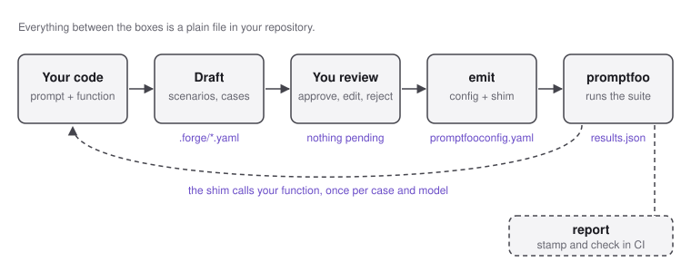

🇺🇸 [English](README.md) · 🇧🇷 [Português](README.pt.md)

# LLM Tests Forge

[](https://github.com/albertosca/llm-tests-forge/actions/workflows/ci.yml) [](https://github.com/albertosca/llm-tests-forge/actions/workflows/lint.yml) [](https://github.com/albertosca/llm-tests-forge/actions/workflows/ci.yml) [](LICENSE)

Regression suites for the LLM features in your application: drafted by a model, approved by you, and kept as plain files in your repository.


## Quickstart

The forge is a development-only command you install beside your project, never inside your code: it writes everything under `.forge/`, and promptfoo, which runs separately through `npx`, is what calls your function through a small shim. It installs as a dev dependency from npm; the other channels are in [Install](guide/en/install.md).

Install it in the project that holds the prompt, with Node 16.9 or newer:

```
npm i -D llm-tests-forge
```

Then, from that project that holds the prompt and the function that calls the model (the drafter needs a key, such as `ANTHROPIC_API_KEY`):

```
export FORGE_DRAFTER=anthropic/claude-sonnet-5
npx llm-tests-forge init
npx llm-tests-forge describe "what the function does" --prompt-file path/to/prompt.txt
npx llm-tests-forge review      # approve it; then repeat scenarios, cases and review
npx llm-tests-forge emit        # writes .forge/promptfooconfig.yaml and a shim
```

Fill in the one function the shim names so it calls your code, then run `npx promptfoo@0.123.0 eval -c .forge/promptfooconfig.yaml`. The whole chain, with `estimate` and `report`, is in [From your prompt to a promptfoo suite](guide/en/flow.md); two finished suites are in [`examples/moonlighter-classify-email/`](examples/moonlighter-classify-email/) and [`examples/moonlighter-extract-questions/`](examples/moonlighter-extract-questions/).

## Overview

You point the forge at a prompt and the function that calls the model; a model drafts scenarios and test cases with an expected output each, and you review and approve every one of them. The forge then exports the approved suite as a promptfoo config plus a shim that calls your function, so promptfoo runs it against your real code and the forge reports the result and its cost.

<picture>
  <source media="(prefers-color-scheme: dark)" srcset="assets/diagrams/flow-dark.svg">
  
</picture>

- **Prompt in, suite out.** `describe` reads the feature and its prompt; the forge drafts scenarios of six kinds (happy, edge, ambiguous, out-of-scope, adversarial, language) and cases with an expected output each. The step-by-step is in [From your prompt to a promptfoo suite](guide/en/flow.md).
- **Exports to promptfoo.** `emit` writes a promptfoo config plus a shim that calls your function in Python, JavaScript, TypeScript, Elixir, Ruby, Rust or Go, or any command or HTTP endpoint. `--format jsonl` writes the same cases for a runner of your own.
- **You decide what is correct.** A model drafts; every scenario and case stays pending until you approve it in `review`, and `emit` refuses while any is pending.
- **Cost and drift.** `estimate` prices a run before it is spent, `report` compares real cost against it, and `stamp` seals a passing run so `check` can verify in CI, offline, that nothing it was earned on has moved.

## Guarantees

- An agent never approves anything: approval is a person's act, and the manual the forge gives agents says so.
- `emit` writes nothing while any scenario or case is pending, and never overwrites the shim you filled in.
- `estimate` makes no API call, shows a range rather than a point, and leaves a model it cannot price out of the total instead of guessing.
- `check` reads files and compares; it calls no model.

## Design notes

| Decision | Trade-off |
|---|---|
| The forge writes a config and promptfoo runs it | One emitter today, and a dependency on promptfoo's config format; no runner of its own to maintain. |
| Expected outputs are YAML in your repository | A change to what "correct" means is a diff someone has to read; there is no hosted dataset to keep in step. |
| Estimates are ranges, calibrated on a few committed runs | A calibrated guess, not a budget. |
| Sealing is offline | It proves one run passed on those inputs, not that the feature works. |
| 100% line and function coverage, plus mutation tests on every module | Bun measures no branch coverage, so the gate is a floor, not proof the suite is complete. |

The full list is in [Engineering decisions](guide/en/decisions.md).

## Limits

promptfoo is the only emitter today. It tests one turn at a time, keeps no history beyond a `--baseline` comparison. [More](guide/en/development.md#limitations).

## Documentation

- [From your prompt to a promptfoo suite](guide/en/flow.md): the flow and what `emit` produces.
- [Install](guide/en/install.md): channels, platforms, verifying a download.
- [Building a suite](guide/en/building-a-suite.md) and [Running a suite](guide/en/running-a-suite.md): every verb.
- [The nine target kinds](guide/en/targets.md): the shim for each language, `exec` and `http`.
- [Agents, files and exit codes](guide/en/project-files.md): what to commit under `.forge/`.
- [Limitations and development](guide/en/development.md) and [Engineering decisions](guide/en/decisions.md).

## Contributing and security

Read [CONTRIBUTING.md](CONTRIBUTING.md) before opening a pull request, report vulnerabilities as [SECURITY.md](SECURITY.md) describes, and follow the [Code of Conduct](CODE_OF_CONDUCT.md). What changed in each release is in the [changelog](CHANGELOG.md).

## License

MIT © Alberto Cavalcanti, see [LICENSE](LICENSE).
